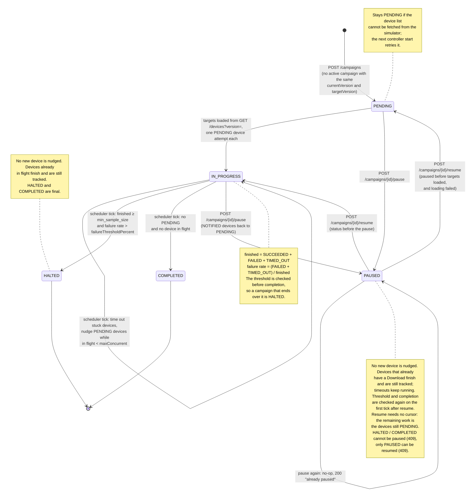

# Firmware Upgrade Campaign Controller

A controller that upgrades a fleet of devices in campaigns. The
controller cannot reach a device directly: it nudges it with a Connection
Request, the device calls back with an Inform, and only in that session
can the controller return a Download. The device then downloads,
reboots and reports the outcome later, in a new session, with the same
`commandKey`.

The controller enforces `maxConcurrent`, halts a campaign whose failure
rate exceeds `failureThresholdPercent`, times out every waiting state,
survives a restart mid-campaign, and exposes request metrics.

## How to run

Requires Python 3.10+. The simulator lives next to this repository, in
`../device_similator`.

```bash
# Controller, from att_controller/
python3 -m venv .ctr_venv && . .ctr_venv/bin/activate
pip install -r docs/requirements.txt
uvicorn controller:app --app-dir scripts --host 0.0.0.0 --port 8080

# Simulator, from device_similator/ in another terminal
# (it needs fastapi, uvicorn and httpx)
CONTROLLER_URL=http://localhost:8080 DEVICE_COUNT=1000 \
  uvicorn scripts.fw_simulator:app --port 9000
```

Start a campaign and follow it:

```bash
curl -X POST localhost:8080/campaigns -H 'Content-Type: application/json' -d '{
  "targetVersion": "2.0.0",
  "imageUrl": "http://images.example/fw-2.0.0.bin",
  "deviceFilter": {"currentVersion": "1.0.0"},
  "maxConcurrent": 50,
  "failureThresholdPercent": 25
}'

curl localhost:8080/campaigns/<id>          # status and progress
curl -X POST localhost:8080/campaigns/<id>/pause
curl -X POST localhost:8080/campaigns/<id>/resume
curl localhost:8080/metrics                 # request and event counters
```

State is kept in `data/controller.db`. Stop the controller and delete
`data/` to start with no campaigns.

## API

| Endpoint | Purpose |
|---|---|
| `POST /campaigns` | Create a campaign. Returns 201 with its `id`. An identical campaign that is still active (`PENDING`, `IN_PROGRESS`, `PAUSED`) is returned instead of creating a second one. |
| `GET /campaigns/{id}` | Parameters, status, `createdAt` / `pausedAt` / `endedAt`, and progress: counts per device state, failures per reason, failure rate, `minSampleSize`. |
| `POST /campaigns/{id}/pause` | Stop nudging new devices. 200 if already paused, 409 if `HALTED` or `COMPLETED`. |
| `POST /campaigns/{id}/resume` | Continue a paused campaign. 409 if it is not `PAUSED`. |
| `GET /metrics` | Request counters by endpoint and status code, Informs by event, protocol events. |
| `POST /devices/{id}/inform` | Device session. Returns the commands for the device (at most one Download). |
| `POST /devices/{id}/command-response` | Device's answer to a Download: `ACCEPTED` or `REJECTED`. |
| `GET /health` | Liveness. |

Unknown campaign IDs return 404.

## Architecture

One FastAPI process. The endpoints and a background scheduler share
in-memory state behind one lock; every change is written through to
SQLite.

```
scripts/
  controller.py   FastAPI app, lifespan, thin endpoints, metrics middleware
  campaigns.py    campaign lifecycle: create, load targets, progress,
                  HALTED/COMPLETED, pause/resume, issuing the Download
  devices.py      device state machine, timeouts, TransferComplete and
                  BOOT evidence, command-responses
  scheduler.py    the mini scheduler
  db.py           SQLite persistence
  metrics.py      counters served by GET /metrics
  state.py        shared state and the lock
  log.py          log format
  config.py       loads config.yml
```

Imports go one way, `config → log → state/db → devices → campaigns →
scheduler → controller`, so there are no cycles. Request models live
with the module that handles them.

**The scheduler** runs every `scheduler_tick_sec` in a worker thread, so
the API keeps serving. Each tick, under the lock: time out devices stuck
in a waiting state, halt or complete campaigns, then move up to
`maxConcurrent − inFlight` `PENDING` devices to `NOTIFIED`. The
Connection Requests are sent after the lock is released, because the
devices call back while they are being sent.

**Concurrency.** Sync endpoints run in FastAPI's thread pool next to the
scheduler thread. A single `threading.Lock` guards every
check-then-update of the state; no HTTP call is made while holding it.
One lock is enough at this scale and keeps the reasoning simple.

## Device state machine

Source: [docs/device_status.mmd](docs/device_status.mmd)

```mermaid
stateDiagram-v2
    direction TB

    [*] --> PENDING : campaign created,<br/>device listed by GET /devices?version=

    PENDING --> NOTIFIED : scheduler tick, campaign IN_PROGRESS,<br/>in flight < maxConcurrent and retryAt passed;<br/>connection request sent
    NOTIFIED --> PENDING : connection request failed, campaign paused<br/>or controller restarted: no Download yet,<br/>so nudged again on a later tick

    NOTIFIED --> DOWNLOAD_SENT : CONNECTION_REQUEST inform,<br/>DOWNLOAD returned with commandKey
    NOTIFIED --> PENDING : no inform in 60s, retries left:<br/>retry=n/2 after 30s, then 60s<br/>reason=NO_CALLBACK (safe to resend)
    NOTIFIED --> TIMED_OUT : still no inform after 3 connection requests<br/>reason=NO_CALLBACK (offline)

    DOWNLOAD_SENT --> ACCEPTED : command-response ACCEPTED
    DOWNLOAD_SENT --> FAILED : command-response REJECTED<br/>reason=REJECTED
    DOWNLOAD_SENT --> TIMED_OUT : no command-response in 60s<br/>reason=NO_ACK

    ACCEPTED --> SUCCEEDED : TransferComplete faultCode=0
    ACCEPTED --> FAILED : TransferComplete faultCode≠0<br/>reason=FAULT
    ACCEPTED --> SUCCEEDED : BOOT on target version<br/>(no TransferComplete)
    ACCEPTED --> FAILED : BOOT on old version<br/>reason=REVERTED
    ACCEPTED --> FAILED : BOOT on another version<br/>reason=UNEXPECTED_VERSION
    ACCEPTED --> ACCEPTED : BOOT within 5s of ACCEPTED<br/>ignored as stale (MIN_REBOOT_SEC)
    ACCEPTED --> TIMED_OUT : no outcome in 600s<br/>reason=NO_COMPLETION

    TIMED_OUT --> ACCEPTED : late command-response ACCEPTED
    TIMED_OUT --> SUCCEEDED : late TransferComplete faultCode=0<br/>or late BOOT on target version
    TIMED_OUT --> FAILED : late REJECTED, faultCode≠0<br/>or late BOOT on old version

    SUCCEEDED --> [*]
    FAILED --> [*]

    note right of TIMED_OUT
        Provisional: a late callback with the
        same commandKey can still correct it.
    end note

    note left of SUCCEEDED
        SUCCEEDED and FAILED are final.
        Duplicate or late callbacks are
        logged and ignored.
    end note
```



`NOTIFIED`, `DOWNLOAD_SENT` and `ACCEPTED` are the in-flight states that
count toward `maxConcurrent`. The in-flight count is derived from the
statuses, not kept in a counter, so it cannot drift.

## Campaign state machine

Source: [docs/campaign_status.mmd](docs/campaign_status.mmd)



## Design decisions and trade-offs

**Success evidence.** A device is `SUCCEEDED` on a TransferComplete with
`faultCode=0` **or** a BOOT reporting the target version. Requiring both
would fail healthy devices that never send BOOT and devices that never
send TransferComplete, both of which the simulator produces.

**Devices that come back without a TransferComplete** (requirement 4).
The reported `firmwareVersion` is the evidence: target version →
`SUCCEEDED`; old version → `FAILED` with reason `REVERTED`; any other →
`FAILED` with `UNEXPECTED_VERSION`. A BOOT less than `min_reboot_sec`
after `ACCEPTED` is ignored: it is a duplicated BOOT from before the
Download, not the reboot that applied it.

**Correlation and idempotency.** Each Download gets a fresh UUID
`commandKey`; TransferCompletes and command-responses are matched on it.
Once a device is `SUCCEEDED` or `FAILED`, duplicates are logged and
ignored. A CONNECTION_REQUEST Inform only gets a Download if the device
is `PENDING` or `NOTIFIED`, so a duplicated callback never produces a
second Download.

**`TIMED_OUT` is provisional.** A late callback with the right
`commandKey` corrects it to the real outcome. A slow device is not a
failed device, and the simulator delays some callbacks by minutes.

**Retry safety** (requirement 7). Some steps are safe to repeat, some
are not:

| Step | Safe to retry? | On timeout |
|---|---|---|
| Connection Request (`NOTIFIED`) | Yes: it only asks the device to call back, no command was sent yet. | Back to `PENDING` with `reason=NO_CALLBACK`, nudged again after `retry.backoff_sec`, then twice that. After `retry.max_retries` resends: `TIMED_OUT` (`NO_CALLBACK`). |
| Download (`DOWNLOAD_SENT`, `ACCEPTED`) | No: the device may already be installing it. A second Download could install twice or race the first. | `TIMED_OUT` (`NO_ACK` or `NO_COMPLETION`), never resent; a late callback with the same `commandKey` still corrects it. |

A device waiting to retry does not hold a `maxConcurrent` slot. A
Connection Request that cannot be sent puts the device back to `PENDING`
for the next tick.

**Failure threshold.** Failure rate = (`FAILED` + `TIMED_OUT`) / finished
devices. It is checked only once `min_sample_size` devices have
finished, with a strict `>`, on every tick, before any new device is
nudged. Once `HALTED`, no new device is nudged, but devices already in
flight are still tracked to their outcome, so log activity continues for
a while after the halt. Early samples are skewed toward fast outcomes:
rejects come back in seconds, successes take a download and a reboot.

**Pause and resume.** Pause stops new nudges only; devices with a
Download in progress finish and timeouts keep running. `NOTIFIED`
devices go back to `PENDING`, otherwise a callback during the pause would
get no Download and end as `NO_CALLBACK`. Resume needs no cursor: the
remaining work is exactly the devices still `PENDING`.

**Persistence** (requirement 8). Memory is the working copy; SQLite is
the durable one. Two tables, `campaigns` and `campaign_devices` (one row
per device attempt), are written through on every transition, under the
lock, before the controller answers. In particular the `commandKey` is
saved before the Download leaves. At startup the campaigns are reloaded
before the scheduler starts. `NOTIFIED` devices go back to `PENDING`
(their callback may have been lost while the controller was down);
`DOWNLOAD_SENT` and `ACCEPTED` keep waiting, and their saved
`commandKey` still matches late callbacks. Callbacks sent while the
controller is down are lost, since devices do not resend them: those
devices end `TIMED_OUT` unless a later Inform brings evidence. The
device inventory and the metrics are not saved: Informs and traffic
rebuild them.

**Targets** come from the simulator's `GET /devices?version=` at
creation. A production controller would query its own persisted device
inventory instead.

**Metrics** (requirement 9). `GET /metrics` returns JSON: incoming
requests by route template and status code, outgoing requests
(Connection Requests, device listing) by status code, `timeout` or
`connection_error`, Informs by event, and protocol events (Downloads
issued, Connection Request retries, duplicates, unknown `commandKey`s,
stale BOOTs). Route templates
keep one counter per endpoint, not per device. Counters restart with the
controller; `startedAt` gives the window. Campaign progress is served by
`GET /campaigns/{id}`, not duplicated here.

**Logging.** One line per event: UTC time, level, one subject tag
(`[GW-…]` or `[campaign <id>]`), then `key=value` details. Device
failures are expected outcomes and log at INFO; WARN is for unexpected
but handled input and for `HALTED`; ERROR means the controller itself
failed. PERIODIC Informs log at DEBUG. Colours only on a terminal.

## Configuration

[config.yml](config.yml), every value commented in place.

| Key | Value | Why |
|---|---|---|
| `simulator_url` | `http://localhost:9000` | Where the fleet is listed and Connection Requests are sent. |
| `timeouts.notified_sec` | 60 | The simulator calls back within 3 s; offline devices never do. |
| `timeouts.download_sent_sec` | 60 | The command-response follows the Download almost immediately. |
| `timeouts.accepted_sec` | 600 | Download (up to 20 s) plus reboot (up to 240 s) in the simulator, with margin for late callbacks. |
| `retry.max_retries` | 2 | Resends of the Connection Request after the first: 3 in total before `NO_CALLBACK`. |
| `retry.backoff_sec` | 30 | Wait before the first resend, doubled each time, so a briefly offline device has time to come back. |
| `scheduler_tick_sec` | 2 | A freed slot waits at most one tick before it is refilled. |
| `min_sample_size` | 20 | The threshold is not judged on the first few outcomes. A fleet smaller than this never halts. |
| `min_reboot_sec` | 5 | The real BOOT comes at least 7 s after `ACCEPTED` (download ≥ 2 s + reboot ≥ 5 s); a duplicated callback comes at most 5 s after the original. |
| `log_level` | `INFO` | `DEBUG` adds PERIODIC Informs and access lines. |
| `db_path` | `data/controller.db` | Relative to `config.yml`. |

## Known limitations and next steps

- **Retry count is not persisted yet.** After a controller restart, a
  device waiting to retry starts again from 0 retries and is nudged on
  the next tick.
- **`NO_CALLBACK` counts toward the failure rate.** An offline device
  never received the image, so it says nothing about the firmware.
  Excluding it is a one-line change, marked `TODO` in `campaign_counts`.
- **PERIODIC is not used as evidence.** A device that upgraded while the
  controller was down reports the target version in its next PERIODIC
  Inform; using it would turn those `NO_COMPLETION` timeouts into
  `SUCCEEDED`.
- **Late callbacks are not restricted by timeout reason.** A late
  command-response should only correct a `NO_ACK` timeout, and a late
  BOOT only a `NO_COMPLETION` one.
- **Single instance.** One process, one lock, one SQLite file.
